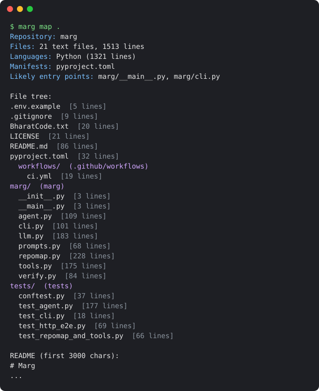
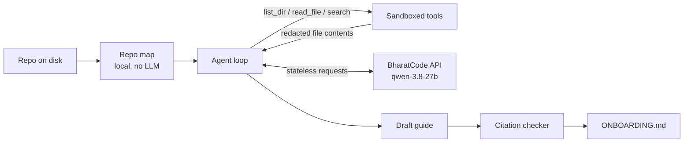

# Marg

**Point it at a repo. Get an onboarding guide you can trust.**

Marg (मार्ग, "path") is a command line agent that explores a codebase the way a senior engineer would on day one, then writes `ONBOARDING.md`: how to run it, an architecture diagram, a walkthrough of one real flow, good first tasks, gotchas and a glossary. Every `file:line` reference in the guide is checked against the code the agent actually read.

It runs on the [BharatCode model API](https://bharatcode.ai/build), has zero dependencies, and never writes to your repo except for the guide.

```bash
pip install git+https://github.com/mqhnish/marg
export BHARATCODE_API_KEY=bc_live_...      # free for students at bharatcode.ai/account
marg guide path/to/repo                     # writes path/to/repo/ONBOARDING.md
```

**See real output** from `qwen-3.8-27b` (how each was made is in [examples/](examples/README.md)):

- [Express](examples/express-ONBOARDING.md), the Node.js web framework: 108 citations verified, 0 unverified. It even spotted a wrong return type in Express's own JSDoc for `req.query`.
- [The same guide in Hindi](examples/express-ONBOARDING.hi.md), written with `--lang hi`: 98 verified, 0 unverified.
- [Marg's guide to its own code](examples/marg-ONBOARDING.md): 88 verified, 0 unverified.

## Why

Joining a new codebase usually means a week of clicking through files and asking "where does X happen?". READMEs explain how to install, rarely how the code fits together. LLM chat helps, but answers about code you haven't read are hard to trust.

Marg makes the model do the reading. It gets read-only tools, a step budget, and a strict output format, and it has to cite what it read. Citations that point at lines it was never shown, or at line numbers that don't exist, are flagged in the guide footer.

## Commands

| Command | What it does | Needs a key |
|---|---|---|
| `marg map [path]` | Prints the local repo map: languages, manifests, likely entry points, file tree | No |
| `marg guide [path] [-o FILE]` | Explores the repo and writes an onboarding guide (default `ONBOARDING.md`) | Yes |
| `marg ask "question" [path]` | Answers one question about the code, with citations | Yes |

Useful flags: `--max-steps N` (step budget: model turns before it must write, default 30 for guides), `--model ID` (default `qwen-3.8-27b`), `--api chat` (use Chat Completions instead of Responses), `--lang LANG` (see below), `-q` (quiet).

```bash
marg ask "where are API routes registered and how is auth checked?" ~/code/my-service
```

## Guides in Indian languages

Many developers read faster in their first language, so Marg can write the guide in Hindi (`hi`), Bengali (`bn`), Tamil (`ta`), Telugu (`te`), Marathi (`mr`), Gujarati (`gu`), Kannada (`kn`), Malayalam (`ml`), Punjabi (`pa`), Odia (`or`), Assamese (`as`) or Urdu (`ur`):

```bash
marg guide path/to/repo --lang hi -o ONBOARDING.hi.md
marg ask "where is auth checked?" path/to/repo --lang Tamil
```

Only the prose changes. Code, commands, file paths and `path:line` citations are kept exactly as they are, so every citation is still checked. Headings are translated with the English kept in brackets, so a mixed team can follow either one. Technical words developers normally say in English (API, commit, request) stay in English.

Here is `marg map` run on this repo. It works offline and is the head start the agent gets before it reads any code:



## How it works



1. **Repo map** (`marg/repomap.py`). A local pass collects the file tree, line counts, languages, manifests (`package.json`, `pyproject.toml`, `go.mod`, `Dockerfile`...), likely entry points and the README. It respects `.gitignore` and skips build output, binaries and secret files. This saves the model a dozen tool calls.
2. **Agent loop** (`marg/agent.py`). The model gets the map plus three read-only tools and explores until it has enough, then writes the guide. When the budget runs out it is told to stop and write. If the answer is cut off by the output limit, Marg asks it to continue.
3. **BharatCode client** (`marg/llm.py`). It uses the Responses API with function tools by default (`--api chat` for Chat Completions). BharatCode's API is stateless, so Marg replays the history each step with `store: false`. Requests that come back `503` (model busy) or `429` are retried with backoff. The output limit includes reasoning, so a turn that gets cut off is retried with double the budget (up to 32,000 tokens), and tool calls from a cut-off turn are never run.
4. **Citation checker** (`marg/verify.py`). Every `` `path:line` `` in the output is checked: does the file exist, is the line in range, and was the agent actually shown those lines? The result goes in the guide footer.

## Safety

Marg sends parts of your code to the BharatCode API, so it is careful about what leaves your machine:

- Tools are **read-only** and **sandboxed** to the repo root. `../` paths and absolute paths outside the repo are refused.
- **Secret files are never read**: `.env`, `*.pem`, `*.key`, `id_rsa*`, `*credentials*` and similar.
- **Common token formats are redacted** from file contents before they are sent: OpenAI, BharatCode, GitHub, AWS, Google and Slack keys, private key blocks, and `password = "..."` style assignments.
- `.gitignore`d paths, `node_modules`, virtualenvs and build output are skipped, and the tools refuse to read them.
- Your API key is read from the environment only.

Redaction is a safety net, not a guarantee. Don't point Marg at code you aren't allowed to share with a third-party API.

## Development

```bash
git clone https://github.com/mqhnish/marg && cd marg
pip install -e ".[dev]"
pytest -q
```

The tests cover the repo map, sandboxing and redaction, citation checking, both API styles, stateless history replay, retries, budget exhaustion, truncated output and cut-off tool calls. They include an end-to-end run of the real CLI over HTTP against a local fake of the BharatCode API, so no key or network is needed.

## Built for

The [BharatCode Build League](https://bharatcode.ai/hackathon), category *Coding & developer tools*. If Marg saves you a confused afternoon, a star helps.

## Licence

MIT
