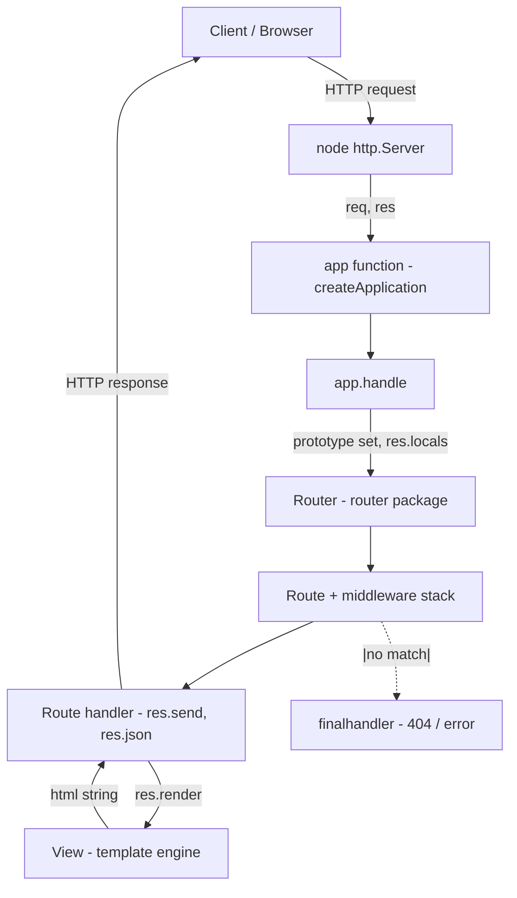

# आनबोर्डिंग गाइड: express (Onboarding guide: express)

## एक पैराग्राफ में (In one paragraph)

यह repository `express` framework का source code है, यानी Node.js के लिए fast, unopinionated, minimalist web framework (`Readme.md:8`)। इसका version `5.3.0` है और इसे Node.js 18+ चाहिए (`package.json:82-84`, `Readme.md:55-56`)। इस्तेमाल करने वाला कोई developer है जो HTTP server / API / website बनाना चाहता है; Express आपको routing, HTTP helpers, view system और content negotiation देता है, मगर ORM या template engine force नहीं करता (`Readme.md:119-127`)। Core सिर्फ़ `lib/` के कुछ ही files में है: एक application object, एक `req` और `res` prototype, और एक `View` class। असली routing बाहर से आता है (`router` package), body parsing `body-parser` से, static files `serve-static`/`send` से, और last-resort 404/error `finalhandler` से (`package.json:34-63`)।

## इसे locally चलाएँ (Run it locally)

पहले Node.js 18+ होना चाहिए, फिर dependencies install करें (`Readme.md:55-65`):

```bash
npm install
```

इस repo में कोई `start` script नहीं है। `package.json` में सिर्फ़ ये scripts हैं (`package.json:91-98`):

```bash
npm test            # mocha unit + acceptance tests
npm run lint        # eslint .
npm run lint:fix    # eslint . --fix
npm run test-ci     # nyc + npm test (lcov coverage)
npm run test-cov    # nyc + npm test (html coverage)
npm run test-tap    # mocha का tap reporter
```

`npm test` असल में ये चलाता है: `mocha --require test/support/env --reporter spec --check-leaks test/ test/acceptance/` (`package.json:94`)। यानी `test/` की unit tests और `test/acceptance/` की example-based tests दोनों चलती हैं, और `test/support/env.js` से पहले `NODE_ENV=test` set होता है (`test/support/env.js:2-3`)।

कोई app run करके देखने के लिए examples को सीधे node से चलाइए (`Readme.md:143-147`):

```bash
node examples/hello-world
node examples/content-negotiation
```

हर example में `if (!module.parent)` guard के अंदर `app.listen(3000)` है, इसलिए सीधे run करने पर port 3000 पर server उठता है, मगर test में require करने पर server नहीं बनेगा (`examples/hello-world/index.js:11-15`)। Note: Readme का Quick Start `npm start` बताना है, मगर वह `express-generator` से बनी app के लिए है, इस repo के लिए नहीं (`Readme.md:89-114`)।

CI में lint अलग job है (`npm run lint`) और tests को `npm run test-ci` से Node 18-26 matrix पर ubuntu + windows पर चलाया जाता है (`.github/workflows/ci.yml:38-42`, `.github/workflows/ci.yml:70-80`)।

## आर्किटेक्चर (Architecture)



- `express()` call करने पर `createApplication()` एक function return करता है जो `app.handle` call करता है; यही function बाद में request handler बनता है (`lib/express.js:36-56`)।
- `app` पर `EventEmitter` और application prototype mixin किए जाते हैं, और `app.request` / `app.response` prototypes बनते हैं (`lib/express.js:41-52`)।
- Request आने पर `app.handle` prototypes बदलता है (`setPrototypeOf`), `res.locals` बनाता है, और `finalhandler` को last-resort `done` बनाकर `router.handle` देता है (`lib/application.js:152-178`)।
- `Router` lazy है, सिर्फ़ पहली बार `this.router` access पर बनता है (`lib/application.js:69-82`)। Routes `app.get/post/...` से register होते हैं जो `this.route(path)` पर delegate होते हैं (`lib/application.js:471-482`)।
- Response के लिए `res` prototype का इस्तेमाल होता है (`res.send`, `res.json`, `res.redirect`, `res.render`) जो `http.ServerResponse` से extend होता है (`lib/response.js:43`)।
- View render करने पर `View` class file को extension से ढूँढता है और template engine को `__express` convention से load करता है (`lib/view.js:75-94`)।

## चीज़ें कहाँ हैं (Where things live)

| Path | What it is for |
| --- | --- |
| `index.js` | Entry point, सिर्फ़ `require('./lib/express')` export करता है (`index.js:11`) |
| `lib/express.js` | `createApplication` और सारे public exports (`Router`, `Route`, `json`, `static`, etc) (`lib/express.js:27-81`) |
| `lib/application.js` | App का prototype: settings, `handle`, `use`, `route`, `render`, `listen`, HTTP method delegation (`lib/application.js:59-606`) |
| `lib/request.js` | `req` prototype (`http.IncomingMessage` पर), `get`, `query`, `fresh` जैसे getters (`lib/request.js:30`, `lib/request.js:63-83`, `lib/request.js:230-241`) |
| `lib/response.js` | `res` prototype (`http.ServerResponse` पर), `send`, `json`, `redirect`, `render`, `cookie`, `sendFile` (`lib/response.js:43`, `lib/response.js:126-222`, `lib/response.js:897-921`) |
| `lib/view.js` | `View` class: template engine lookup और render (`lib/view.js:52-95`, `lib/view.js:133-159`) |
| `lib/utils.js` | private helpers: methods list, etag generators, query parser, trust proxy, charset (`lib/utils.js:29`, `lib/utils.js:130-184`) |
| `package.json` | dependencies और npm scripts (`package.json:34-63`, `package.json:91-98`) |
| `test/` | mocha unit tests, हर `req`/`res` method और app behaviour के लिए अलग file |
| `test/acceptance/` | examples को supertest से test करने वाले tests (`test/acceptance/hello-world.js:5-21`) |
| `test/fixtures/` | tests के लिए sample files (`.tmpl`, `.txt`, `views`) |
| `test/support/` | test helpers: `env.js`, `tmpl.js` (mini template engine), `utils.js` (`test/support/tmpl.js:5-23`) |
| `examples/` | runnable sample apps, हर एक अपने `index.js` और views के साथ (`examples/README.md:5-28`) |
| `.github/workflows/` | CI: `ci.yml`, `legacy.yml`, `codeql.yml`, etc |
| `.eslintrc.yml` | lint config: `es2022`, `node`, global `Buffer` forbidden (`.eslintrc.yml:11-14`) |
| `History.md` | changelog, पुराने versions के breaking changes के साथ |

## एक real flow का walkthrough (Walkthrough of one real flow)

एक `GET /` request को trace करते हैं जिसमें view render होता है (`examples/ejs/index.js:45-51` की तरह)।

1. App बनना: `express()` `createApplication()` call करता है, जो एक function return करता है जो `app.handle` call करता है। साथ में `EventEmitter` + application prototype mixin होता है, `app.request`/`app.response` prototypes बनते हैं, और `app.init()` चलेगा (`lib/express.js:36-56`)।
2. Init और defaults: `init()` `cache`/`engines`/`settings` बनाता है और `router` को lazy getter के तौर पर define करता है (`lib/application.js:59-83`)। `defaultConfiguration()` default settings set करता है: `etag` weak, `query parser` simple, `view` = `View`, `views` = `resolve('views')` (`lib/application.js:90-141`)।
3. Server: `app.listen(port)` के अंदर `http.createServer(this)` बनता है, यानी app खुद request handler है (`lib/application.js:598-599`)।
4. Request पहुँचा: app function चला (`lib/express.js:37-39`) जो `app.handle` में गया। `handle` `finalhandler` को `done` बनाता है, `X-Powered-By` header set करता है, `req.res`/`res.req` जोड़ता है, दोनों का `setPrototypeOf` करके app की `request`/`response` prototype पर set करता है, `res.locals` बनाता है, और `this.router.handle(req, res, done)` call करता है (`lib/application.js:152-178`)।
5. Route match: route पहले `app.get(path, ...)` से register हुआ था, जो `app[method]` → `this.route(path)` → `route[method]` की तरफ़ गया था (`lib/application.js:471-482`)। Router matched route का handler चलाता है।
6. Handler में `res.render('users', {...})`: ये `res.render` (`lib/response.js:897`) में जाता है, जहाँ `res.locals` को `opts._locals` में merge होता है, default `done` callback बनता है जो `self.send(str)` call करता है (`lib/response.js:910-917`), फिर `app.render(view, opts, done)` चलाता है (`lib/response.js:920`)।
7. `app.render` (`lib/application.js:522`): locals merge करता है, `new View(name, {...})` बनाता है जहाँ `root = this.get('views')` और `engines` pass होते हैं (`lib/application.js:550-556`)। file नहीं मिली तो error return (`lib/application.js:558-565`)। फिर `tryRender` → `view.render` (`lib/application.js:573-574`, `lib/application.js:625-631`)।
8. `View` class: extension से engine load करता है `require(mod).__express` (`lib/view.js:75-88`), `lookup` सही file ढूँढता है (`lib/view.js:104-123`), `resolve` file या `index.<ext>` check करता है (`lib/view.js:169-187`)। फिर `this.engine(path, options, callback)` call कर html बनाता है (`lib/view.js:133-159`)।
9. HTML तैयार: render का callback `res.render` की `done` से `self.send(str)` पर आता है (`lib/response.js:914-917`)।
10. `res.send` (`lib/response.js:126`): string के लिए default `Content-Type: html` set होता है (`lib/response.js:136-145`), `app.get('etag fn')` से ETag बनता है (`lib/response.js:162-193`), `req.fresh` हो तो 304 (`lib/response.js:196`), और अंत में `this.end(chunk)` call कर response जाता है (`lib/response.js:213-219`)।

कोई route match नहीं हुआ तो `router.handle` की `done` (यानी `finalhandler`) 404/error देता है (`lib/application.js:152-157`)।

## आपकी first tasks (Your first tasks)

1. `examples/hello-world/index.js` में एक नया route (जैसे `app.get('/hi', ...)`) जोड़ें, `node examples/hello-world` से confirm करें, और `test/acceptance/hello-world.js` में supertest assertion add करें।
2. किसी `res` method के लिए unit test लिखें, उदाहरण के लिए `test/res.status.js` या `test/res.send.js` को extend करके (pattern देखें `test/regression.js:6-19`)।
3. `lib/application.js` के `defaultConfiguration` में एक नया default setting add करें और `test/config.js` में उसके लिए test लिखें (`test/config.js:7-34` का pattern)।
4. `test/fixtures` में एक नया view file बनाकर `test/app.render.js` में render test add करें; नया template engine register करने का pattern `test/app.render.js:386-392` में है।
5. कोई lint warning fix करें या कोई छोड़ा हुआ edge case cover करें, और `npm run lint` + `npm test` से confirm करें (`.eslintrc.yml:5-14`)।

## ध्यान देने वाली बातें (Gotchas)

- `res.status()` सिर्फ़ integer लेता है और range 100-999 में होनी चाहिए, वरना `TypeError`/`RangeError` throw होता है। यह v5 में breaking change है (`lib/response.js:65-77`, `History.md:103-107`)।
- `app.get` overloaded है: एक argument के साथ यह setting read करता है, दो arguments के साथ route register करता है (`lib/application.js:471-482`)। इसलिए `app.get('foo')` route नहीं, setting है।
- `Router` lazy बनता है; पहले `this.router` access तक object नहीं बनता (`lib/application.js:69-82`)। Debug करते समय पहले ही `app.router` देखने से router बन जाता है।
- Global `Buffer` allow नहीं है; eslint के हिसाब से `import { Buffer } from "node:buffer"` करना पड़ता है (`.eslintrc.yml:11-14`, देखें `lib/response.js:36`)।
- इस repo में `start` script नहीं है। `npm start` केवल `express-generator` से बनी app के लिए है (`Readme.md:89-114`)। यहाँ examples को सीधे `node examples/<name>` से चलाना होता है।
- हर example में server start करने के लिए `if (!module.parent)` guard है (`examples/hello-world/index.js:11-15`)। यह pattern tests में example को require करके supertest से चलाने के लिए है (`test/acceptance/hello-world.js:2`)।
- View engine file extension से `__express` convention से load होता है; engine न register करने पर `res.render('name')` extension माँगता है वरना "No default engine" error आता है (`lib/view.js:60-62`, `examples/ejs/index.js:23-36`)।
- `view cache` सिर्फ़ `NODE_ENV=production` में on होता है, development में हर बार re-render होता है (`lib/application.js:138-140`)।
- `req.query` का आचरण `query parser` setting पर निर्भर है, default `simple` है जो complex keys नहीं तोड़ता (`lib/request.js:230-241`, `test/req.query.js:25-51`)।

## शब्दावली (Glossary)

- `app`: `express()` से बना application object जो एक function भी है और request handler भी (`lib/express.js:36-39`)।
- `req` / `res`: Node के `http.IncomingMessage` / `http.ServerResponse` पर extend किए गए augmented objects (`lib/request.js:30`, `lib/response.js:43`)।
- `Router` / `Route`: `router` package से आते हैं, `express.Router` / `express.Route` के तौर पर re-export (`lib/express.js:70-71`)।
- middleware: `(req, res, next)` function जो request pipeline में चलता है; `app.use` से add होता है (`lib/application.js:190-244`)।
- view / view engine: template file और उसे render करने वाला engine, `lib/view.js` में `View` class से।
- locals: `app.locals` / `res.locals` data जो render होते समय views में जाते हैं (`lib/application.js:536`, `lib/response.js:910-911`)।
- settings: `app.set` / `app.get` से manage होने वाला key-value config, `app.settings` object में रहता है (`lib/application.js:351-383`)।
- `trust proxy`: proxy के पीछे client IP निकालने वाली setting, `compileTrust` से function बनती है (`lib/application.js:370-371`, `lib/utils.js:194-214`)।
- `etag`: response validation के लिए weak/strong cache token, `lib/utils.js` में generators (`lib/utils.js:130-152`)।
- `finalhandler`: pipeline में सबसे अंत का handler, 404/error respond करता है (`lib/application.js:152-157`)।
- `__express`: template engines द्वारा follow की जाने वाली convention function जो `View` engine को attach करती है (`lib/view.js:81`, `examples/ejs/index.js:23`)।
- acceptance test: `test/acceptance/` में, supertest से examples के against चलेने वाले integration tests (`test/acceptance/hello-world.js:5-21`)।

---

<sub>Generated by [Marg](https://github.com/mqhnish/marg) on the BharatCode API (qwen-3.8-27b) in 31 agent steps. Citations checked: 98 verified against files the agent read, 2 point to real code the agent did not read.</sub>
