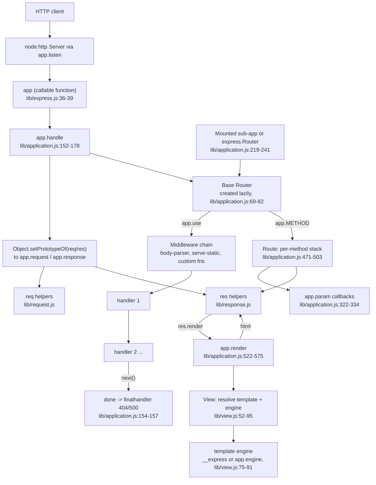

# Onboarding guide: express

## In one paragraph

This is the source repository for Express, the minimalist web framework for Node.js. It is a library, not an application: you publish it to npm (`package.json:2-4` shows the name `express`, version 5.3.0) and downstream developers `npm install express` to build their own HTTP servers, APIs, and sites (`Readme.md:55-68`). The core is a small `lib/` directory in plain CommonJS JavaScript that wraps Node's `http` module: an `app` object that is itself a request handler, `req`/`res` prototype objects extended with helper methods, a view/template system, and settings. All of the heavy lifting (routing, body parsing, static files) is delegated to small npm dependencies such as `router`, `body-parser`, `serve-static`, `send`, `accepts`, and `finalhandler` (`package.json:34-63`). Development is plain JavaScript, no build step, tested with Mocha and SuperTest, and requires Node.js 18 or higher (`package.json:82-84`, `Readme.md:51-53`).

## Run it locally

There is no build step. All commands below are from `package.json:91-98` and `Readme.md`:

```bash
npm install        # install runtime + dev dependencies (Readme.md:140, 167-169)
npm test           # mocha --require test/support/env --reporter spec --check-leaks test/ test/acceptance/
npm run lint       # eslint .
npm run lint:fix   # eslint . --fix
npm run test-ci    # nyc coverage run (what CI uses, .github/workflows/ci.yml:78-80)
npm run test-cov   # nyc with HTML coverage report
```

- `Node.js 18 or higher is required` (`Readme.md:51-53`, `package.json:82-84`). CI also tests Node 16/17 on a separate legacy workflow (`.github/workflows/legacy.yml:32-33`).
- There is no top-level runnable app in this repo; the only server code is in `examples/`. The README says to run them with e.g. `node examples/content-negotiation` (`Readme.md:143-147`). I did not run them myself; each example listens on port 3000 only when started directly, guarded by `if (!module.parent)` (e.g. `examples/hello-world/index.js:12-15`).
- Tests set `NODE_ENV=test` for you via `--require test/support/env` (`package.json:94`, `test/support/env.js:2`).
- The README's "Quick Start" section is about the separate `express(1)` generator CLI, which lives in another repository, not in this one (`Readme.md:95-117`).

## Architecture



- The exported `express()` does not return a class instance. It returns a function that calls `app.handle` when invoked, and copies the Application prototype onto it; `app.request` and `app.response` are objects created from the `req`/`res` prototypes (`lib/express.js:36-56`).
- Every request re-parents the actual Node `IncomingMessage`/`ServerResponse` prototypes to `app.request`/`app.response` via `Object.setPrototypeOf`, which is how `req.get`, `res.json`, etc. appear on the objects (`lib/application.js:169-170`, prototypes defined as `Object.create(http.IncomingMessage.prototype)` in `lib/request.js:30` and `Object.create(http.ServerResponse.prototype)` in `lib/response.js:43`).
- `app.get/post/...` are not written by hand; they are generated in a loop over `node:http`'s method list, so every Node HTTP method exists, plus a special-cased `app.all` (`lib/application.js:471-503`).
- The base router is created lazily on first access to `this.router` with `caseSensitive` and `strict` from app settings (`lib/application.js:69-82`), and the router itself comes from the external `router` package (`package.json:57`), not from this repo.
- When the chain falls through without a response, the `finalhandler` dependency produces the default 404 or 500 and `logerror` prints it unless `env` is `test` (`lib/application.js:154-157`, `615-618`).
- `express.json`, `express.urlencoded`, `express.static` are not implemented here; they are re-exports of `body-parser` and `serve-static` (`lib/express.js:77-81`).

## Where things live

| Path | What it is for |
|---|---|
| `index.js` | Package entry; just `module.exports = require('./lib/express')` (`index.js:11`) |
| `lib/express.js` | `createApplication()` factory, exposes `Router`, `Route`, and the `json`/`static`/`urlencoded` middleware re-exports (`lib/express.js:36-81`) |
| `lib/application.js` | The `app` prototype: settings (`set`/`get`), `use`, `route`, `param`, `render`, `listen`, and the generated HTTP-verb methods (`lib/application.js:59-631`) |
| `lib/request.js` | Prototype with `req` helpers: `get`/`header`, `accepts*`, `is`, `range`, and getters `query`, `protocol`, `ip`, `fresh`, etc. (`lib/request.js:63-511`) |
| `lib/response.js` | Prototype with `res` helpers: `status`, `send`, `json`, `jsonp`, `sendFile`, `download`, `redirect`, `format`, `render`, cookies (`lib/response.js:65-921`) |
| `lib/view.js` | Template lookup, engine loading (auto-`require(ext).__express`), and render normalization (`lib/view.js:52-159`) |
| `lib/utils.js` | Internals: etag generators, `normalizeType`, `compileETag`, `compileQueryParser`, `compileTrust`, the method list (`lib/utils.js:29-214`) |
| `examples/` | ~25 runnable tutorials, one per feature; most export the app and only listen when run directly (`examples/README.md:1-29`, e.g. `examples/hello-world/index.js:1-15`) |
| `test/` | Unit tests, named one file per API method (e.g. `test/res.send.js`, `test/app.router.js`); use `supertest` to hit the app in-process (`test/app.js:19-23`) |
| `test/acceptance/` | Tests that require whole examples and make HTTP requests against them (`test/acceptance/hello-world.js:2-11`) |
| `test/support/` | Test plumbing: `env.js` sets `NODE_ENV=test` (`test/support/env.js:2`), `tmpl.js` is a toy template engine for fixtures (`test/support/tmpl.js:5-23`), `utils.js` has response assertion helpers (`test/support/utils.js:15-19`) |
| `test/fixtures/` | Static files and `.tmpl` templates used by unit tests (listed in repo map) |
| `History.md` | Version changelog; the top entry describes every behavior change in 5.3.0, useful for understanding recent surprises (`History.md:1-56`) |
| `.github/workflows/ci.yml` | CI: lint job, then a test matrix across Node 18-26 and ubuntu/windows running `npm run test-ci` (`.github/workflows/ci.yml:25-87`) |
| `.eslintrc.yml` | Lint rules; notably forbids the global `Buffer` in favor of `import { Buffer } from "node:buffer"` (`.eslintrc.yml:11-14`) |

## Walkthrough of one real flow

Trace: `GET /` against `examples/ejs/index.js`, which renders a template.

1. The server was started by `app.listen(3000)`, which is just `http.createServer(this).listen(...)` because `app` is itself the request handler function (`lib/application.js:598-606`, `lib/express.js:36-39`).
2. The request reaches `app.handle`. It builds `done` from `finalhandler` (so an unanswered request becomes a 404), sets `X-Powered-By` (enabled by default in `defaultConfiguration`, `lib/application.js:94`), links `req.res`/`res.req`, and re-parents both objects so the Express helpers become available (`lib/application.js:152-170`). It then calls `this.router.handle(req, res, done)` (`lib/application.js:177`).
3. The base router (lazily created in `lib/application.js:69-82`) matches the route registered by `app.get('/', ...)` in the example (`examples/ejs/index.js:45-51`). `app.get` is the generated method that calls `this.route(path)` and then `route.get(...)` (`lib/application.js:471-482`).
4. The handler runs `res.render('users', { users, title, header })`.
5. `res.render` merges `res.locals` into the options as `opts._locals`, wraps a default callback that either calls `req.next(err)` or `self.send(str)`, and delegates to `app.render` (`lib/response.js:897-921`).
6. `app.render` builds `renderOptions` as a spread of `this.locals`, `opts._locals`, and `opts`, applies the `view cache` setting (enabled automatically when `env` is production, `lib/application.js:138-140`), and constructs a `View` with `defaultEngine` from the `view engine` setting and `root` from `views` (`lib/application.js:522-575`). In the example those settings are set at `examples/ejs/index.js:27` and `examples/ejs/index.js:36`.
7. The `View` constructor: the name `users` has no extension, so the extension comes from `defaultEngine` (`html`), which was registered via `app.engine('.html', require('ejs').__express)` in the example (`examples/ejs/index.js:23`, stored by `app.engine` at `lib/application.js:294-308`). Engines not yet registered are auto-loaded with `require(ext).__express` (`lib/view.js:75-88`). `View.lookup`/`resolve` stat `<root>/users.html`, then `<root>/users/index.html` (`lib/view.js:104-187`).
8. `view.render` forces the engine callback to be async via `process.nextTick` and hands the HTML back through the callback chain (`lib/view.js:133-159`).
9. Back in `res.render`'s default callback, `self.send(str)` runs `res.send` (`lib/response.js:914-920`): a string body gets `Content-Type: text/html`, a weak ETag is generated from the `etag` setting (default `'weak'`, `lib/application.js:95`), `Content-Length` is set only if there is no `Transfer-Encoding` (a 5.3.0 fix, `lib/response.js:180-185`, `History.md:4-9`), a fresh revalidation check may downgrade the response to 304 (`lib/response.js:195-196`, `lib/request.js:469-486`), and finally `this.end(chunk, encoding)` writes the response (`lib/response.js:213-219`).

## Your first tasks

1. Add a new example and acceptance test. Copy the pattern of `examples/hello-world/index.js` (export the app, guard `listen` with `if (!module.parent)`) and `test/acceptance/hello-world.js`, wire it into `examples/README.md:1-29`, and note that `npm test` already picks up everything in `test/` and `test/acceptance/` (`package.json:94`).
2. Write a unit test for an existing `res` method you have not read yet, e.g. `res.links` (`lib/response.js:98-111`), following the style of `test/app.js:19-23` (supertest against a bare app) or one of the `test/res.*.js` files.
3. Add or fix JSDoc comments: many public methods document parameters with `@param {String}` that no longer match the code (e.g. `lib/request.js:226-228` says `@return {String}` for `req.query`, which returns an object).
4. Tidy the examples tree: the MVC example's views live at `examples/mvc/controllers/user/views/*.hbs` (confirmed by `list_dir`), but the repository map labels the directory as `examples/mvc/controllers/user-pet/views` and `examples/mvc/controllers/pet/views` mixes `.ejs` files with `user/views` `.hbs` files. Verify what actually renders (`examples/mvc/controllers/user/index.js:24-34` uses `hbs`) and clean up or document it.
5. Try running a single test file in isolation, e.g. `npx mocha --require test/support/env test/res.send.js`, and compare what breaks versus `npm test` to understand what `--check-leaks` and the acceptance suite cover.

## Gotchas

- `app.get` is overloaded: with one argument it returns a setting (`app.get('env')`), with two or more it registers a route (`lib/application.js:471-479`, `lib/application.js:351-354`). Forgetting this is the most common source of confusion.
- The "app" is not an object with methods; it is a function with methods mixed in, and `req`/`res` extensions only exist because of per-request `Object.setPrototypeOf` (`lib/express.js:37-54`, `lib/application.js:169-170`). Sub-apps mounted via `app.use` temporarily re-parent to the sub-app's prototypes and restore them afterwards (`lib/application.js:229-237`).
- Error handlers are middleware that have four arguments (`err, req, res, next`); they must be registered after the routes they should catch, and a route-level error handler only fires for errors from preceding handlers in that route stack (`examples/error/index.js:14-17`, `44-47`; route-scoped behavior shown in `test/app.routes.error.js:25-60`). Without any handler, `finalhandler` answers 500 and `logerror` prints the error unless `env === 'test'` (`lib/application.js:154-157`, `615-618`).
- `express.Router` and `express.Route` come from the external `router` package, not this repo (`lib/express.js:70-71`, `package.json:57`); so do `express.json`/`raw`/`text`/`urlencoded` (body-parser) and `express.static` (serve-static) (`lib/express.js:77-81`). Bugs in routing or body parsing live upstream.
- `res.send(object)` silently becomes `res.json(object)` (`lib/response.js:148-157`), and `res.send(string)` defaults to `text/html` (`lib/response.js:134-145`); the type is inferred, not stated.
- Template engines are auto-loaded from the view file extension via `require(ext).__express`; an engine that does not export that hook fails with "Module ... does not provide a view engine" (`lib/view.js:75-88`). `res.render('name')` without an extension requires the `view engine` setting (`lib/view.js:60-62`, `lib/application.js:552-556`).
- `res.status()` now throws on non-integers or codes outside 100-999 instead of clamping (`lib/response.js:65-77`).
- The codebase mixes `'use strict'` CommonJS with occasional ES module imports (e.g. `import { Buffer } from "node:buffer"` is mandated by lint, `.eslintrc.yml:11-14`); do not use the global `Buffer`.
- The QUERY HTTP method handling in `req.fresh` (`lib/request.js:474-475`) depends on Node >= 22; tests skip it below that (`test/support/utils.js:79-85`).
- CI pins action versions by SHA (`.github/workflows/ci.yml:30-34`) and tests an aggressive Node matrix up to Node 26 (`.github/workflows/ci.yml:44-49`); local runs only need one Node >= 18.
- I did not run the examples or the full test suite myself; the commands above are taken from the manifest and README and should be verified on first run.

## Glossary

- **app**: the result of `express()`; a callable request handler function with the Application prototype mixed in (`lib/express.js:36-42`). Not a class instance.
- **base router**: the lazily created `router`-package `Router` owned by an app (`lib/application.js:68-82`); `app.use`, `app.route`, and all `app.METHOD` calls proxy into it.
- **middleware**: any `(req, res, next)` function added with `app.use` or to a route; `(err, req, res, next)` functions are error handlers (`examples/error/index.js:14-17`).
- **Route**: an isolated middleware stack for one path and its per-method handlers; created by `app.route(path)` (`lib/application.js:256-258`).
- **Router**: a reusable, mountable middleware+route container, re-exported from the `router` package (`lib/express.js:71`), as in `examples/multi-router/controllers/api_v1.js:5-7`.
- **mount / mountpath / parent**: relationships set when one app or router is added to another via `app.use(path, child)`; the child gets `mountpath` and `parent`, and inherits settings via prototype chaining on the `mount` event (`lib/application.js:109-122`, `225-240`; paths composed in `app.path()`, `lib/application.js:399-403`).
- **settings / app.set / app.get**: string-keyed config on `this.settings`; certain keys compile into derived function settings like `etag fn`, `query parser fn`, `trust proxy fn` (`lib/application.js:351-383`, `lib/utils.js:130-214`).
- **locals**: `app.locals` and per-response `res.locals`, merged into every `app.render` call as render options, in the order `app.locals`, `res.locals` (`_locals`), then per-call options (`lib/application.js:125`, `536-536`, `lib/response.js:911`).
- **View**: a resolved template: name, extension, root directories, and engine function (`lib/view.js:52-95`).
- **view engine**: the `view engine` setting naming the default template extension used when `res.render` is called without one (`lib/view.js:66-73`, `lib/application.js:552-556`).
- **__express**: the convention for how template engines hook in; `View` auto-loads `require('<ext>').__express` unless `app.engine` registered something else (`lib/view.js:75-88`, `lib/application.js:261-292`).
- **fresh / stale**: whether the request's validators (ETag/Last-Modified) match the response; a fresh `res.send` responds 304 with an empty body (`lib/request.js:469-499`, `lib/response.js:195-204`).
- **trust proxy**: setting compiled by `compileTrust` that controls whether `X-Forwarded-*` headers are honored by `req.ip`, `req.ips`, `req.host`, `req.protocol` (`lib/utils.js:194-214`, `lib/request.js:297-366`).
- **acceptance test**: a test under `test/acceptance/` that requires a full example app and exercises it over HTTP with supertest (`test/acceptance/hello-world.js:2-11`).
- **unit test**: a test under `test/` named after the API it covers (e.g. `test/res.format.js`), typically building a minimal app inline.

---

<sub>Generated by [Marg](https://github.com/mqhnish/marg) on the BharatCode API (qwen-3.8-27b) in 21 agent steps. Citations checked: 108 verified against files the agent read, 7 point to real code the agent did not read.</sub>
