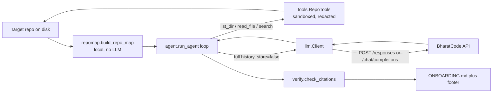

# Onboarding guide: marg
## In one paragraph
Marg is a zero-dependency Python command line agent that points at any repository, explores it with three read-only tools, and writes an `ONBOARDING.md` for a newcomer, with every `file:line` citation verified against the lines the agent actually saw. It is for developers joining an unfamiliar codebase (and, per `README.md:82`, it was built for the BharatCode Build League hackathon). The technical choices: standard library only, with the LLM HTTP client hand-rolled on `urllib` and `threading` (`marg/llm.py:1-9`, `pyproject.toml:20`); a single model, `qwen-3.8-27b`, behind the OpenAI-compatible BharatCode API, using the Responses API by default and Chat Completions as a fallback style (`marg/llm.py:26-27`, `marg/cli.py:68-69`); and a stateless request model where the full conversation is replayed every step with `store: false` (`marg/llm.py:7-9`).

## Run it locally
Confirmed from `README.md:72-76` and `.github/workflows/ci.yml:13-19`:
```bash
git clone https://github.com/mqhnish/marg && cd marg
pip install -e ".[dev]"        # dev extra is just pytest (pyproject.toml:22-23)
pytest -q
```
There is no Makefile or scripts directory; those two commands are the only build/test steps in the repo. CI runs the same `pip install -e ".[dev]"` + `pytest -q` on Python 3.9, 3.11 and 3.13 (`.github/workflows/ci.yml:10-19`).

To run the CLI for real you need an API key, read from the environment only (`marg/llm.py:131`, `.env.example:2`):
```bash
export BHARATCODE_API_KEY=bc_live_...
marg map path/to/repo                          # works offline, no key (marg/cli.py:22-24)
marg guide path/to/repo -o OUT.md              # writes the guide (marg/cli.py:27-45)
marg ask "question" path/to/repo               # one cited answer (marg/cli.py:48-55)
```
Optional overrides: `--model` / `$MARG_MODEL` and `--base-url` / `$BHARATCODE_BASE_URL` (`marg/cli.py:67-70`, `marg/llm.py:131-133`, `.env.example:4-5`). The tests need no key and no network: they inject a scripted transport or run a local fake HTTP server (`tests/test_http_e2e.py:10-29,32-55`, `tests/test_agent.py:10-22`).

## Architecture

- `marg/cli.py` wires three subcommands (`map`, `guide`, `ask`) to either `repomap` alone or `agent` (`marg/cli.py:73-89`).
- The repo map is built locally before any LLM call: file tree with line counts, languages, manifests, entry points and the first 3000 chars of the README (`marg/repomap.py:172-196`, `226-244`).
- `agent.run_agent` is a while loop over model turns; each turn either returns tool calls to execute or final markdown text (`marg/agent.py:86-131`).
- `llm.Client.step` posts the system prompt plus the entire history, gets back a normalized `Turn` (text, tool calls, truncated flag, usage), and normalises both API styles into it (`marg/llm.py:167-231`).
- `tools.RepoTools` enforces the sandbox (paths stay under the repo root) and redacts token patterns before anything is sent; it also records what it showed, which the citation checker later uses (`marg/tools.py:54-59`, `21-39`, `94,110`).
- After the text is final, `verify.check_citations` classifies every backticked `path:line` reference and `render_footer` appends the results to the guide (`marg/agent.py:139-141`, `marg/verify.py:36-95`).

## Where things live
| Path | What it is for |
|---|---|
| `README.md` | User-facing docs: commands, flags, how it works, safety notes (`README.md:21-68`) |
| `pyproject.toml` | Packaging; declares zero runtime deps and the `marg = marg.cli:main` console script (`pyproject.toml:20-26`) |
| `.env.example` | Env var template: key plus optional model and base URL (`.env.example:1-5`) |
| `BharatCode.txt` | Hackathon submission text describing the API usage and file roles (`BharatCode.txt:1-20`) |
| `.github/workflows/ci.yml` | CI matrix: 3.9/3.11/3.13, install dev extra, `pytest -q` (`.github/workflows/ci.yml:8-19`) |
| `marg/__main__.py` | `python -m marg` entry, delegates to `main()` (`marg/__main__.py:1-3`) |
| `marg/cli.py` | argparse setup, `cmd_map` / `cmd_guide` / `cmd_ask`, error handling |
| `marg/agent.py` | The explore-then-write loop, history compaction, cutoff and budget handling |
| `marg/llm.py` | Hand-rolled HTTP client: retries, deadline, both API styles, `Turn` normalization |
| `marg/prompts.py` | System prompts for guide and ask, plus the two nudge messages (`marg/prompts.py:1-53`) |
| `marg/repomap.py` | Local map builder: walk, ignore rules, languages, manifests, tree rendering |
| `marg/tools.py` | The three model-facing tools, path sandbox, redaction, tool specs |
| `marg/verify.py` | Citation regex, checker, footer renderer |
| `tests/conftest.py` | `sample_repo` fixture: tiny Flask repo with secrets, gitignored dirs, a binary (`tests/conftest.py:7-37`) |
| `tests/test_agent.py` | Loop behavior: replay, cutoffs, retries, budget, compaction, citations |
| `tests/test_http_e2e.py` | Real CLI + real `urllib` against a local fake BharatCode server |
| `tests/test_repomap_and_tools.py` | Map walk, sandbox, redaction, read limits |
| `tests/test_cli.py` | CLI exit codes and key-less behavior |

## Walkthrough of one real flow
`marg guide /some/repo` end to end:
1. `main()` parses args; `guide` resolves `path` (default `.`) and calls `cmd_guide` (`marg/cli.py:93-101`, `27-33`).
2. `Client` is built from `--model`, `--api`, `--base-url`; if `BHARATCODE_API_KEY` is unset and no custom transport was injected, it raises `LLMError`, which `main` prints and turns into exit code 1 (`marg/llm.py:140-144`, `marg/cli.py:97-99`; see `tests/test_cli.py:11-14`).
3. `write_guide` builds the repo map and renders its summary (`marg/agent.py:145-148`). `build_repo_map` walks the repo, skipping `.gitignore`d paths, `ALWAYS_IGNORE_DIRS`, binaries and secret files, and reads the first 3000 chars of a root README (`marg/repomap.py:172-196`).
4. The user prompt is the summary plus "Explore the code with your tools..." (`marg/prompts.py:56-61`); the system prompt is `GUIDE_SYSTEM`, which mandates the exact section list and citation rules (`marg/prompts.py:1-37`).
5. `run_agent` starts the loop with `history = [user prompt]` (`marg/agent.py:77,86`). Each iteration calls `client.step(system, history, TOOL_SPECS, budget)` (`marg/agent.py:95`), which for the default style POSTs `{"input": [system, *history], "store": False, "max_output_tokens": budget}` to `/responses` (`marg/llm.py:173-198`).
6. If the turn has tool calls, each is dispatched through `RepoTools.call`, which JSON-parses the arguments, runs the tool, and returns error strings instead of raising (`marg/tools.py:139-155`). `read_file` records `files_read` and the exact line ranges shown, then redacts tokens in the body and appends a `[rel: lines start-end of N]` footer (`marg/tools.py:94,110-115`).
7. Tool results are appended to history in the right shape per API style and the loop continues (`marg/agent.py:120-128`, `marg/llm.py:200-202,229-236`).
8. If `steps > max_steps`, the next request carries no tools and a `FINAL_NUDGE` message, forcing text (`marg/agent.py:88-91,95`, `marg/prompts.py:48-51`). If the model's output was `truncated`, Marg either asks it to continue or drops the turn (never running its tool calls) and doubles the output budget up to 32000 tokens (`marg/agent.py:105-118`).
9. When plain text arrives, it is joined, any pre-title narration is chopped off (`marg/agent.py:133-138`), then `check_citations` validates every backticked `path:line` against existence, line range and the recorded `ranges_read` (`marg/agent.py:139`, `marg/verify.py:36-78`), and `render_footer` appends the stats block (`marg/verify.py:81-95`).
10. `cmd_guide` writes the markdown to `-o FILE` or `<repo>/ONBOARDING.md` (creating parent dirs) and logs step/tool/token/citation counts to stderr, silenced by `-q` (`marg/cli.py:34-45`).

## Your first tasks
1. Add a language to `LANGUAGES` (e.g. `.tf` -> Terraform, `.zig` -> Zig) at `marg/repomap.py:32-41` and cover it in `tests/test_repomap_and_tools.py` next to `test_repo_map_skips_ignored_binary_and_secret_files`.
2. Add a new pattern to `REDACTIONS` for a token format you know, in `marg/tools.py:21-33`, and extend `test_redact_generic_assignment` in `tests/test_repomap_and_tools.py:64-66`.
3. Add a `marg map --json` flag: wire it in `build_parser`/`cmd_map` (`marg/cli.py:22-24,58-75`) by serializing `RepoMap` (`marg/repomap.py:115-134`), with a test in `tests/test_cli.py`.
4. Extend the citation checker for the `Makefile`/`Dockerfile`/`Procfile` branch of the `CITATION` regex (`marg/verify.py:13`); there is no test that exercises those extensionless names.
5. Tweak the guide template wording in `GUIDE_SYSTEM` (`marg/prompts.py:1-37`) and confirm `pytest tests/test_agent.py` still passes, since several tests assert on guide structure and the footer (`tests/test_agent.py:37,52,259-262`).

## Gotchas
- `--max-steps` is a turn budget, not a tool-call budget: one step can contain several tool calls, and `steps` counts API turns (`marg/agent.py:87-88,123-127`), while the README calls it a "tool budget" (`README.md:29`).
- `read_file` never returns more than 400 lines no matter what `end_line` you pass; the cap is `start + MAX_READ_LINES - 1` (`marg/tools.py:16,98-99`).
- History is replayed whole every step, and once it passes 200,000 chars, `compact_history` rewrites the oldest tool outputs to a stub telling the model to call the tool again, which burns budget it may not have (`marg/agent.py:21-25,44-62,92-93`).
- Tool calls in a truncated turn are silently discarded and the request is retried with a bigger budget; after 3 cutoffs Marg gives up on growing it and accepts the truncated text (`marg/agent.py:20,105-118`; see `tests/test_agent.py:141-177`).
- The retry set is `{429, 500, 502, 503, 504}` plus anything flagged `retryable`, up to 6 attempts with 2s to 30s backoff (`marg/llm.py:28,146-164`); the README only mentions 503/429 (`README.md:55`).
- Each HTTP request runs in a daemon thread abandoned at a 900s wall-clock deadline because socket timeouts only fire on inactivity; one real run froze for 73 minutes this way (`marg/llm.py:29-31,67-87`).
- Tool errors never crash the run: bad JSON, unknown tools, traversal attempts and unreadable files all come back to the model as `error: ...` strings (`marg/tools.py:142-155`).
- The citation regex only catches backticked paths that have an extension or are exactly `Makefile`, `Dockerfile`, `Procfile` (`marg/verify.py:13`); bare names that are not real files are treated as prose, and absolute paths only count if they resolve inside the repo (`marg/verify.py:43-49`).
- `.env.example` is explicitly whitelisted so it can be read, while `.env` itself is refused by both the map and the tools (`marg/repomap.py:59-69`, `marg/tools.py:85-86`).
- `marg ask` prints unverified citations to stderr but writes no footer, unlike `guide` (`marg/cli.py:53-54`, `marg/agent.py:145-154`).
- The only write to the target repo is the guide file itself, created with `mkdir(parents=True)` (`marg/cli.py:34-36`).
- `README.md:37` links `docs/marg-map.svg`, which does not appear in the repository file listing, so I could not confirm that image exists.

## Glossary
- **Repo map**: the local, LLM-free summary of a repository (tree, line counts, languages, manifests, entry points, README excerpt) built by `marg/repomap.py:172-244`; it is the model's head start.
- **Turn**: one normalized model response: `text`, `tool_calls`, `truncated`, `raw_items` to replay, `usage` (`marg/llm.py:46-52`).
- **Stateless replay**: BharatCode keeps no conversation server-side, so every request resends `[system] + history` with `store: false` (`marg/llm.py:7-9,177`).
- **Step / tool budget**: the `--max-steps` limit on agent loop iterations; at exhaustion the model is sent `FINAL_NUDGE` with tools removed (`marg/agent.py:86-91`, `marg/prompts.py:48-51`).
- **Cutoff**: a turn cut off by `max_output_tokens` (status `incomplete` / finish_reason `length`); handled by continuation or retry with a doubled budget (`marg/agent.py:105-118`, `marg/llm.py:197,226`).
- **Nudge**: the two scripted user messages, `FINAL_NUDGE` (budget spent) and `CONTINUE_NUDGE` (output truncated) (`marg/prompts.py:48-53`).
- **Citation**: a backticked `path:line` or `path:start-end` in the output; classified as `valid`, `unread`, `bad_lines`, or `missing` by `marg/verify.py:16-29`.
- **Redaction**: regex substitution of token-looking strings (AWS, OpenAI, BharatCode, GitHub, Slack, Google, private keys, `password = "..."`) with `[REDACTED_*]` before contents leave the machine (`marg/tools.py:21-39`).
- **Transport**: the injectable `(url, headers, body) -> json` callable; tests pass a scripted one or a local server instead of the real `http_transport` (`marg/llm.py:55,137`).
- **sample_repo**: the pytest fixture in `tests/conftest.py:7-37` that builds a tiny Flask repo with a secret, gitignored paths and a binary, used by most tests.

---

<sub>Generated by [Marg](https://github.com/mqhnish/marg) on the BharatCode API (qwen-3.8-27b) in 9 agent steps. Citations checked: 88 verified against files the agent read, 1 point to real code the agent did not read.</sub>
