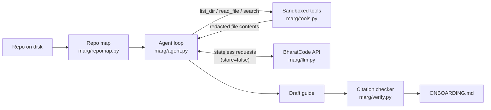

# ஆன்போர்டிங் வழிகாட்டுதல்: marg (Onboarding guide: marg)

## ஒரு பத்தியில் (In one paragraph)

Marg என்பது command line agent. உங்களுடைய repo-ஐ அதைக்கு point செய்தால், அது `list_dir`, `read_file`, `search` என்ற மூன்று read-only tools மூலம் code-ஐ உண்மையிலேயே படித்து, ஒரு onboarding guide (`ONBOARDING.md`) எழுதுகிறது. Guide-லிருக்கும் ஒவ்வொரு `path:line` citation-வும் agent அந்த lines-ஐ அசலிலேயே பார்த்துள்ளதா என்பது check செய்யப்படுகிறது (`marg/verify.py:1-5`). இது stdlib Python மட்டும்; runtime dependencyகள் zero (`pyproject.toml:20`). Model calls BharatCode model API-க்கு போகின்றன, default model `qwen-3.8-27b` (`marg/llm.py:26-27`). இது BharatCode Build League hackathon-ஐக்கான project (`BharatCode.txt:1-2`), guide-ஐ 12 Indian languages-லும் எழுத முடியும் (`marg/prompts.py:58-72`).

## உள்ளூரில் இயக்குவது (Run it locally)

Development setup, README-லிருந்து (`README.md:89-93`):

```bash
git clone https://github.com/mqhnish/marg && cd marg
pip install -e ".[dev]"
pytest -q
```

CI-யும் சரியாக இதையே run செய்கிறது: `pip install -e ".[dev]"` அப்புறம் `pytest -q`, Python 3.9/3.11/3.13 மட்டிரீ (`ci.yml:10-19`).

அசல் commands பயன்படுத்த (`README.md:11-15`):

```bash
export BHARATCODE_API_KEY=bc_live_...
marg guide path/to/repo        # path/to/repo/ONBOARDING.md எழுதுகிறது
marg map path/to/repo          # API key தேவையில்லை, local repo map print செய்கிறது
marg ask "question" path/to/repo
```

`BHARATCODE_API_KEY` environment variable-லிருந்தே மட்டும் படிக்கப்படுகிறது; key இல்லாமல் `guide`/`ask` run செய்தால் cleanning exit (`marg/llm.py:167-181`, `marg/cli.py:111-113`). `map` command-க்கு key வேண்டாம் (`marg/cli.py:87-89`). `--max-steps`, `--model`, `--api chat`, `--lang`, `-q` என்பன useful flags (`marg/cli.py:77-85`).

## வடிவமைப்பு (Architecture)



- Repo map முழுதும் local: API call எதுவும் இல்லாமல் file tree, languages, manifests, likely entry points, README-ன் முதல் 3000 chars தயாராகிறது (`marg/repomap.py:184-210`, `marg/repomap.py:261-279`).
- Agent loop-ல் ஒவ்வொரு step-லும் முழு history-யும் API-க்கு replay செய்யப்படுகிறது, ஏனெனில் BharatCode API stateless (`marg/llm.py:6-8`, `marg/llm.py:229-235`).
- Tools read-only + sandboxed: repo root-ஐ விட்டு வெளியேறும் paths reject, secrets files தொடவே தீர்ந்து, file contents சேர்ந்த token formats redact (`marg/tools.py:54-59`, `marg/tools.py:85-90`, `marg/tools.py:21-33`).
- Draft முடிந்ததும் three post-processing passes: Mermaid label repair, script check (non-English மட்டும்), citation check + footer (`marg/agent.py:142-153`).
- எந்த file-க்கும் write செய்யாமல்; guide மட்டும் CLI level-ல் `out.write_text` ஆகிறது (`marg/cli.py:43-45`).

## எல்லாம் எங்கே (Where things live)

| Path | What it is for |
|---|---|
| `marg/cli.py` | Entry point: `map`/`guide`/`ask` subcommands, flags, exit codes (`marg/cli.py:69-115`) |
| `marg/agent.py` | explore-then-write loop, budget, truncation handling, history compaction (`marg/agent.py:67-154`) |
| `marg/llm.py` | BharatCode API client: retries, streaming, deadline, Responses/Chat modes (`marg/llm.py:155-297`) |
| `marg/tools.py` | Agent-க்கு கொடுக்கும் 3 tools + sandbox + redaction (`marg/tools.py:46-193`) |
| `marg/repomap.py` | Local repo map: tree, languages, manifests, entry points, secrets skip (`marg/repomap.py:16-279`) |
| `marg/prompts.py` | System prompts, nudge texts, language rules (`marg/prompts.py:1-117`) |
| `marg/verify.py` | Citation checker + guide footer (`marg/verify.py:44-104`) |
| `marg/mermaid.py` | Mermaid label-லான `()`, `[`, `\n` mistakes repair (`marg/mermaid.py:21-33`) |
| `marg/script.py` | தவறான script-ல (எ.கா. Tamil-ல Korean) எழுதப்பட்ட words detect + repair (`marg/script.py:106-141`) |
| `tests/` | pytest suite: unit tests + local fake server-ஈடான HTTP e2e (`tests/test_http_e2e.py:1-7`) |
| `examples/` | உண்மையில் generate ஆன guides + எப்படி ஆனது (`examples/README.md:5-11`) |
| `.env.example` | தேவையான env vars: `BHARATCODE_API_KEY`, optional `MARG_MODEL`, `BHARATCODE_BASE_URL` (`.env.example:1-5`) |
| `docs/marg-map.svg` | இந்த repo-மீது `marg map` run செய்த output (`README.md:52-54`) |

## ஒரு உண்மையான flow-ன் walkthrough (Walkthrough of one real flow)

`marg guide ~/code/some-repo` அழைக்கும்போது நடப்பது, step by step:

1. **CLI parse.** Console script `marg` -> `marg.cli:main` (`pyproject.toml:26`). `main` parser-ஐ build செய்து subcommand-ஐ call செய்கிறது; `guide`-க்கு default path `.`, default `--max-steps 30` (`marg/cli.py:91-96`, `marg/cli.py:107-115`).
2. **cmd_guide.** Path resolve, அப்புறம் `write_guide`-ஐ call (`marg/cli.py:35-42`).
3. **Repo map.** `write_guide` முதலில் `build_repo_map` + `render_summary` run செய்கிறது; இது model-க்கு head start ஆக user prompt-ல போகிறது (`marg/agent.py:157-162`, `marg/prompts.py:104-109`). System prompt = `GUIDE_SYSTEM` + language rules (`marg/agent.py:160`).
4. **Agent loop.** `run_agent` while loop: ஒவ்வொரு step-லும் `client.step(system, history, TOOL_SPECS, budget)` (`marg/agent.py:89-98`). `Client.step` Responses mode-ல `store: false` + முழு history-ஔட `input` array-ல send (`marg/llm.py:229-241`).
5. **Tool calls.** Model `read_file` போன்ற call வந்தால் `RepoTools.call` run; `files_read`/`ranges_read` track ஆகின்றன, results `client.tool_results` மூலம் history-க்கு add (`marg/agent.py:124-131`, `marg/tools.py:139-155`, `marg/llm.py:294-297`).
6. **Budget.** `steps > max_steps` ஆனால் `FINAL_NUDGE` add செய்து tools=None ஆகும், அடுத்த turn-ல் model எழுத வேண்டும் (`marg/agent.py:91-94`, `marg/prompts.py:48-51`). Output limit-ல cut off ஆனால் budget double (max 32,000), cut-off turn-ல உள்ள tool calls run செய்யப்படாமல் drop (`marg/agent.py:108-121`, `marg/llm.py:34`).
7. **Post-processing.** Draft திரும்பினால்: `fix_mermaid` labels சரிசெய்கிறது (`marg/agent.py:142-144`, `marg/mermaid.py:21-33`); lang != en என்றால் script check/repair (`marg/agent.py:146-149`, `marg/script.py:106-141`); `check_citations` ஒவ்வொரு citation-மும் file உண்டா, line range சரியா, அந்த lines model-க்கு shown ஆனதா என check (`marg/agent.py:151`, `marg/verify.py:44-87`).
8. **Output.** Footer append, `AgentResult` return; CLI அது `root / "ONBOARDING.md"`-ல் write செய்து, steps/tool calls/citations summary log செய்கிறது (`marg/agent.py:152-154`, `marg/verify.py:90-104`, `marg/cli.py:43-53`).

`marg ask` flow ஒரே loop-லே; வேறுபாடுகள்: default `max_steps 15`, footer இல்லை, output stdout-ல print (`marg/cli.py:98-103`, `marg/agent.py:165-170`).

## உங்களுடைய முதல் tasks (Your first tasks)

1. **புதிய language add செய்க:** `LANGUAGES`-ல entry (`marg/prompts.py:58-72`) + `SCRIPTS`-ல script name (`marg/script.py:20-24`). Test: `foreign_words`-க்கு ஒரு case (`tests/test_script.py:14-21`).
2. **புதிய redaction pattern add செய்க:** `REDACTIONS` list-ல regex (`marg/tools.py:21-33`); `tests/test_repomap_and_tools.py`-ல `test_read_file_redacts_tokens`-ஈடான test (`tests/test_repomap_and_tools.py:34-37`).
3. **Repo map-ஐ extend செய்க:** புதிய manifest அல்லது entry point name (`marg/repomap.py:43-57`); `tests/test_repomap_and_tools.py:5-17`-ஈடான assertion-கள்.
4. **`read_file` limits-க்கான test எழுது:** 400 lines / 24,000 chars cap எப்படி truncate ஆகிறது, footer என்ன சொல்கிறது (`marg/tools.py:16-17`, `marg/tools.py:101-115`); `tests/test_repomap_and_tools.py:26-31` pattern பார்த்து எழுதலாம்.
5. **Citation regex-ஐ மேம்படுத்து:** backticked மற்றும் bare citation formats (`marg/verify.py:13-21`); `marg/agent.py`-ல `check_citations` call-ஐப் பயன்படுத்திய tests (`tests/test_agent.py:40-52`).

## Gotchas (Gotchas)

- **API stateless-ம்:** ஒவ்வொரு step-லும் முழு history resend. History பெரிதானால் பழைய tool outputs stub ஆகின்றன (`HISTORY_CHAR_BUDGET = 200_000`, `KEEP_RECENT_OUTPUTS = 6`) (`marg/agent.py:21-27`, `marg/agent.py:46-64`). Tool output-ஐ நீங்கள் சிறிதாக்கினால் model-க்கு கிடைக்கும் context-மும் சேமிக்கும்.
- **Citation-க்கு "shown" மட்டும் போதாது, "read"-லும் இருக்க வேண்டும்:** file படித்திருந்தாலும் அந்த line range `ranges_read`-ல இல்லை என்றால் "unread" ஆக flag ஆகும் (`marg/verify.py:82-86`, `marg/tools.py:109-110`).
- **`read_file` limit-கள்:** 400 lines அல்லது 24,000 chars-ல truncate; model-க்கு `start_line` கொடுத்து மீண்டும் read செய்ய சொல்லுகிற footer தானாக வருகிறது (`marg/tools.py:16-17`, `marg/tools.py:112-115`).
- **REQUEST_DEADLINE:** ஒரு request 1800 வினாடி மீறும் எனில் daemon thread drop செய்து retry (`marg/llm.py:29-32`, `marg/llm.py:69-89`). நேரடியாக socket timeout-ஐ சரிசெய்வதல்ல, thread join-ம் deadline.
- **Reasoning tokens எழுத்து budget-லே எண்ணப்படுகின்றன.** ஆகவே script repair-க்கு `reasoning="none"` use, இல்லையென்றால் "it never got to the answer" (`marg/llm.py:220-223`, `marg/script.py:120-121`).
- **e2e tests network/key வேண்டாமா:** local `HTTPServer` fake-ஐ `--base-url` மூலம் point செய்கிறது (`tests/test_http_e2e.py:1-7`, `tests/test_http_e2e.py:43-48`).
- **macOS python.org builds-ல CA certs இல்லை** என்றால் `/etc/ssl/cert.pem` fallback (`marg/llm.py:60-66`).
- **`.env.example` secret அல்ல:** `.env`, `.env.sample`, `.env.template` மட்டும் secrets skip-லிருந்து விலகல் (`marg/repomap.py:76-80`).
- **Script repair code-ஐ தொடாது:** code spans முன்/பின் compare ஆகிறது, மாற்றம் இருந்தால் draft அப்படியே திரும்பும் (`marg/script.py:138-139`).
- **`ask`-க்கு default budget 15, `guide`-க்கு 30** (`marg/cli.py:94`, `marg/cli.py:101`).

## சொல்லவளம் (Glossary)

- **BharatCode API:** இந்த project இயங்கும் model API; base URL `https://bharatcode.ai/api/model/v1` (`marg/llm.py:26`).
- **Turn:** model-லிருந்து வரும் ஒரு response; text + tool calls + truncated flag + raw items (`marg/llm.py:48-54`).
- **Step budget:** model எத்தனை turn-கள் எடுக்கலாம் என்ற max (`max_steps`); நிறைந்தால் `FINAL_NUDGE` (`marg/agent.py:91-94`, `marg/prompts.py:48-51`).
- **Repo map:** API call இல்லாமல் local-ல build ஆகும் repo summary (tree, languages, manifests, entry points, README) (`marg/repomap.py:184-210`).
- **Citation:** guide-லிய `path:line` reference; valid = file உண்டு + line range சரியா + அந்த lines agent-க்கு shown (`marg/verify.py:1-5`).
- **Cutoff:** output token limit-ல cut off ஆகும் turn; budget double செய்து retry (`marg/agent.py:108-121`).
- **Script check:** non-English output-ல தவறான script-ல எழுதப்பட்ட words detect + model-ஈடான repair (`marg/script.py:1-7`).
- **Stateless replay:** `store: false`-உடன் ஒவ்வொரு request-லும் முழு history resend (`marg/llm.py:6-8`, `marg/llm.py:233`).
- **Sandboxing:** tools repo root-க்குள் மட்டும்; `../` மற்றும் absolute paths refuse (`marg/tools.py:54-59`).
- **Redaction:** file contents-ல token formats replace செய்வது, send செல்வதற்கு முன் (`marg/tools.py:21-39`).

---

<sub>Generated by [Marg](https://github.com/mqhnish/marg) on the BharatCode API (qwen-3.8-27b) in 8 agent steps. Citations checked: 98 verified against files the agent read, 2 point to real code the agent did not read, 1 could not be verified (listed below). Script check: no words in the wrong script.</sub>

<sub>Unverified citations: `ci.yml:10-19`</sub>
